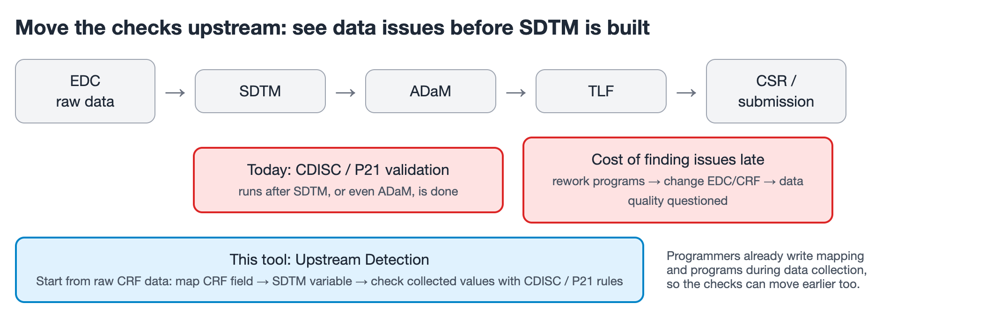
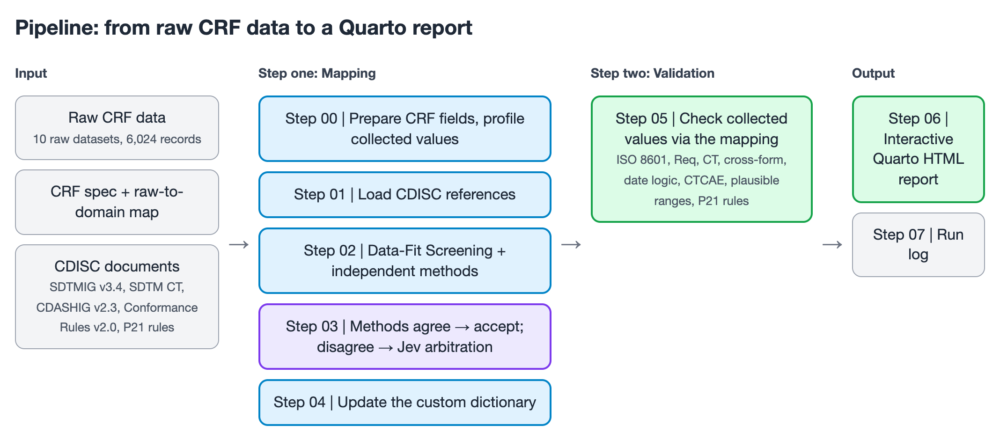
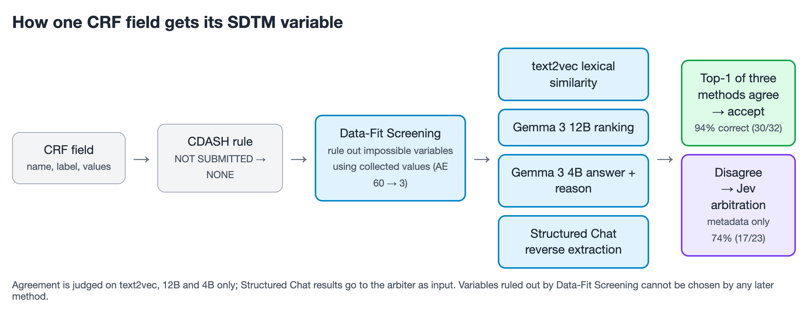
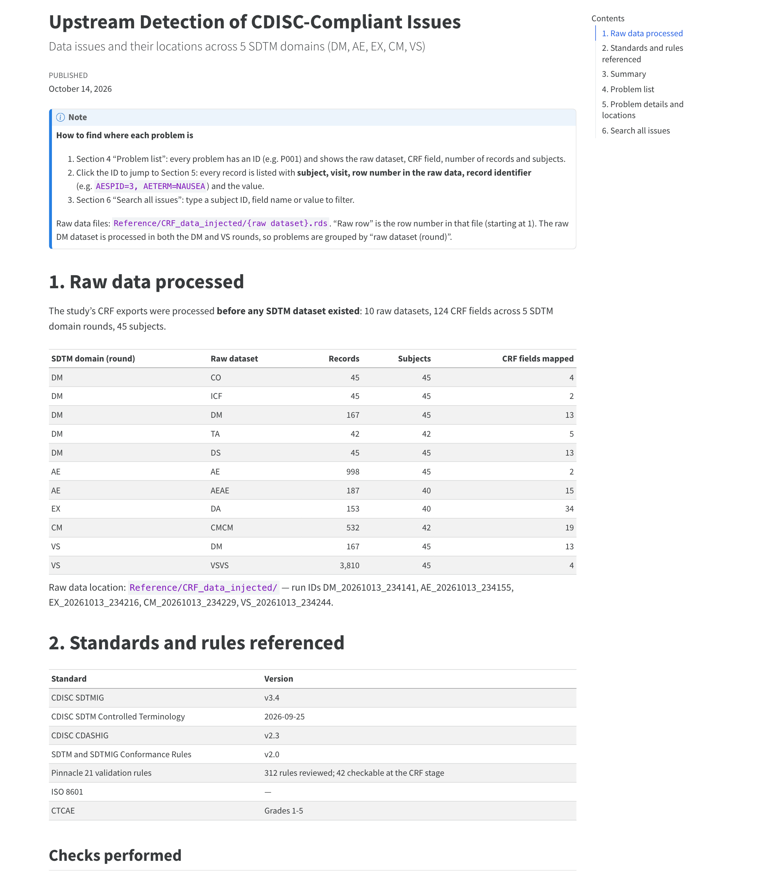
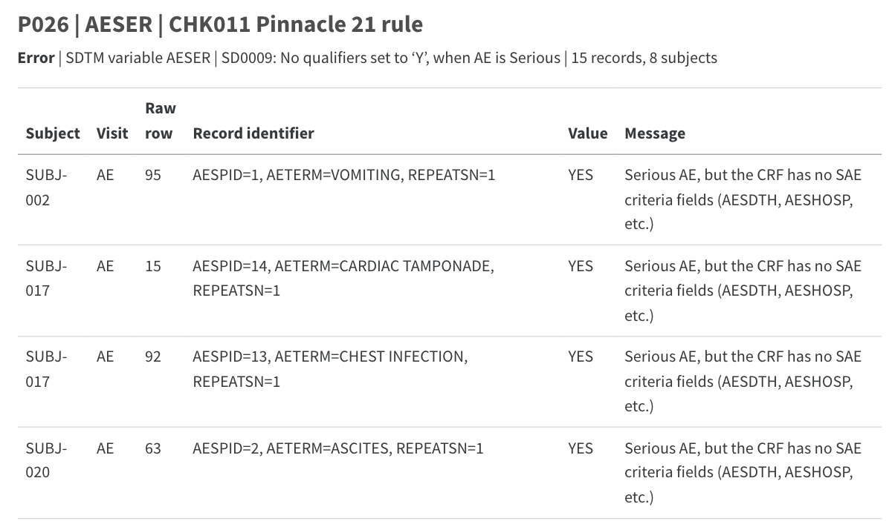
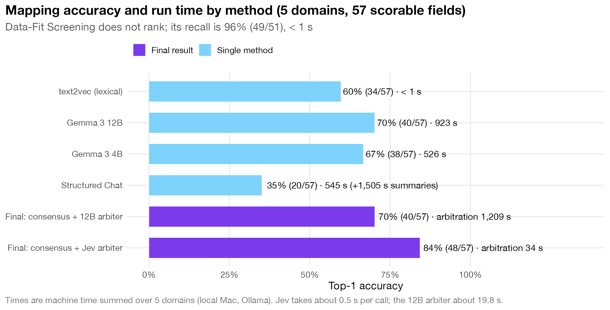
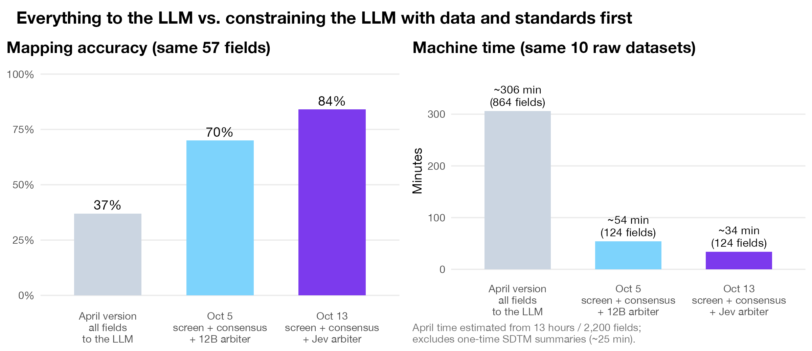
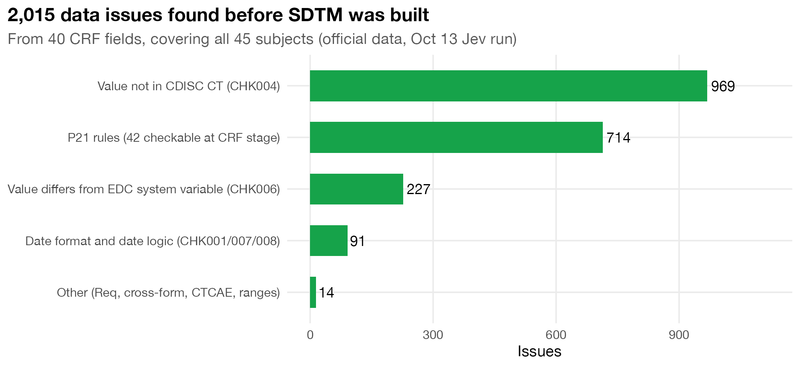
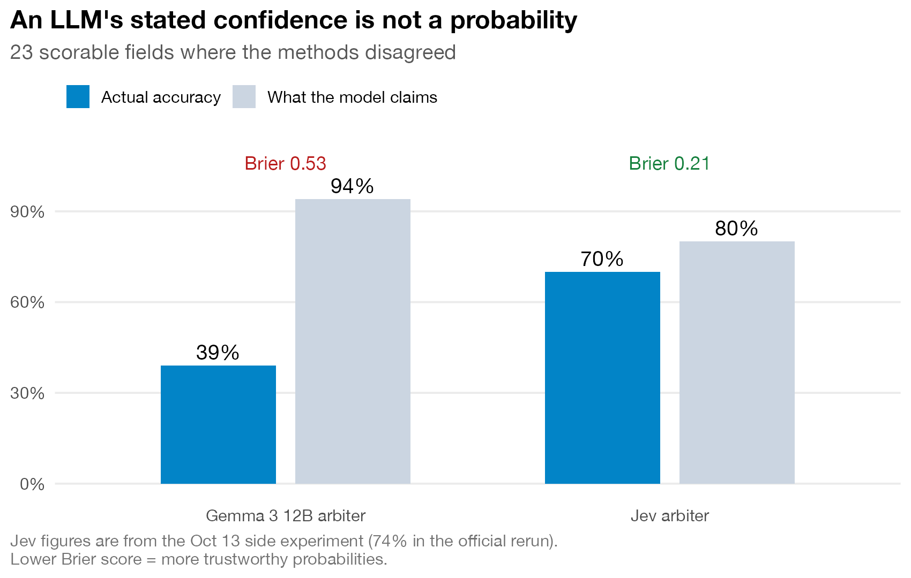

## Why check the data earlier?

In more than ten years of statistical programming for clinical trials, the situation I run into most is this: data issues are found only after SDTM is done. CDISC validation with tools like Pinnacle 21 (P21) usually runs after SDTM, or even ADaM, is complete. By then the programs and specs are already written, so all we can do is go back, rework the programs, and report to Data Management. Serious data issues can even reach back to the EDC and CRF design, and in the worst case call the data quality of the whole study into question. At submission, every unresolved validation issue also has to be explained in the Reviewer's Guide.

In practice, though, we never wait for clean data or database lock to start programming. While DM and PM are still working through queries, programmers are already writing the mapping and SDTM programs. **The work is already upstream. Why is the checking still downstream?**

So for my R/Pharma 2026 APAC lightning talk, I tried this: add one layer next to the existing "raw data → SDTM → ADaM → TLF" flow. Before SDTM is formally built, start from the raw CRF data, apply CDISC rules and P21 rules, and find out which data issues can be caught early, so the team can deal with them early.



## The one-minute summary

- **The idea**: start from raw CRF data, map each CRF field to the SDTM variable it belongs to, then use that mapping to check the collected values against CDISC and P21 rules.
- **Scale**: one mock study, 5 domains (DM, AE, EX, CM, VS), 10 raw datasets, 6,024 records, 45 subjects. 124 CRF fields went into mapping, and 57 of them have a reference answer from the aCRF for scoring.
- **Mapping accuracy: 84%** (48/57, 95% CI 72–93%). When the methods agree, the answer is taken directly (94% correct); only when they disagree does a decision model that gives probabilities, Jev, make the call (74%).
- **2,015 data issues found before SDTM was built**, from 40 CRF fields, covering all 45 subjects. All 5 planted high-risk errors were caught.
- **Compared with my April version, which sent every field to the LLM**: accuracy 37% → 84%, machine time about 306 minutes → about 34 minutes.
- **In one sentence**: LLM output is a suggestion, not an answer. Constrain it with data and standards, let a model that gives real probabilities make the call, and add human review.

## The core idea: add a layer, don't change the process

There are two steps:

1. **Mapping**: map each CRF field to the SDTM variable it should become. For example, `AESTDAT` (Start Date) on the AE form should become `AESTDTC`.
2. **Validation**: once a field is mapped, you know which CDISC rules apply. For example, `AESTDTC` must follow ISO 8601 and must not be later than the subject's last participation date; `SEX` values must be in CDISC Controlled Terminology (CT).

Step two is not hard. Step one is: CRF field names often differ from SDTM variable names (the CRF form is called DA, the SDTM domain is EX), and each domain has dozens of candidate variables.

## Data and reference documents

### The dummy data

| SDTM domain | Raw datasets | Records | Subjects | CRF fields mapped |
|---|---|---|---|---|
| DM | CO, ICF, DM, TA, DS | 344 | 45 | 37 |
| AE | AE, AEAE | 1,185 | 45 | 17 |
| EX | DA | 153 | 40 | 34 |
| CM | CMCM | 532 | 42 | 19 |
| VS | DM, VSVS | 3,977 | 45 | 17 |
| **Total** | **10 dummy datasets** | **6,024** (unique) | **45** | **124** |

- The 10 datasets have 312 variables and 131,390 data cells. Common identifiers (STUDYID, PT, VISIT, etc.) and EDC system variables don't need mapping, which leaves 111 variables that actually need a decision (124 because the raw DM dataset is processed in both the DM and VS rounds).
- But a field isn't judged by its name alone: all **29,229 collected values** in these fields are scanned one by one. That is the biggest difference from approaches that look only at field names.
- Which SDTM domain a raw dataset belongs to comes from an existing mapping table (for example DA → EX); the program does not guess.

### CDISC documents and rules used

| Document | Version | Used for |
|---|---|---|
| SDTMIG | v3.4 | SDTM variable names, labels, types, Core, CDISC Notes |
| SDTM Controlled Terminology | 2026-09-25 | Valid CT values and synonyms |
| CDASHIG | v2.3 | Standard CRF questions, naming conventions, which fields are NOT SUBMITTED |
| SDTM and SDTMIG Conformance Rules | v2.0 | The CDISC rule ID behind each check |
| Pinnacle 21 validation rules | 312 rules | Classified one by one; 42 can be checked at the CRF stage |
| ISO 8601, CTCAE | — | Date/time format, toxicity grades 1–5 |

- **The reference answers used for scoring are kept away from the decision process**: the aCRF answers are used only for scoring afterwards, and no method can see them while deciding. Any rule change must also have a general basis (CDISC/CDASH conventions, common sense about data types), never a tweak made to get one specific field right.

## The pipeline



| Step | What it does |
|---|---|
| Step 00: Prepare CRF | Find this round's raw datasets from the mapping table; drop common identifiers and EDC system variables; profile each field's collected values (type, range, number of distinct values, common values) |
| Step 01: CDISC references | Load SDTMIG variable definitions, valid CT values and Conformance Rules; derive each variable's expected type (date / numeric / coded / text) from SDTMIG |
| Step 02: Mapping | Data-Fit Screening builds a shortlist first; the dictionary, text2vec, Gemma 3 12B, 4B and Structured Chat each decide within it |
| Step 03: Final result | CDASH rule → method consensus → Jev arbitration when methods disagree |
| Step 04: Dictionary | Final results go into the custom dictionary for reuse next time |
| Step 05: Validation | Check the collected values using the final mapping (CHK001–011, MAP001) |
| Step 06: Report | Interactive Quarto HTML report + per-variable drill-down Excel |
| Step 07: Run log | Each run's data volume, method run times and accuracy are logged automatically |

Tech stack: R + tidyverse + text2vec + ellmer + Quarto + YAML. Gemma 3 12B and 4B run locally through Ollama; the arbiter, Jev, is called through an API and receives metadata only. The whole pipeline runs end to end with a single command.

## Step one: how a CRF field gets mapped to an SDTM variable



I'll walk one field through every method: the AE start date, **AESTDAT**.

```
CRF form     : 53.Adverse Events
CRF variable : AESTDAT
CRF label    : Start Date
Values       : 20150422, 20170430, 20160321, 20150413, ... (133 distinct values, all dates)
```

### ① CDASH "not submitted" rule: if the standard says don't submit it, don't ask a model

- The CDASHIG v2.3 Mapping Instructions state which fields are "NOT SUBMITTED / Does not map": screening questions like "Were any adverse events experienced?" (AEYN), SAE-reporting-only fields, and cross-form link IDs. 55 fields in total.
- A CRF variable with the same name as one of these is set to **NONE** directly, without calling any model.
- In this study only AEYN in AE applies, but that one rule alone lifted AE accuracy from 77% to 85% (the LLM had forced it onto AETERM).
- Limitation: it only recognizes standard names. If the CRF calls the field AEVYN, the rule misses it.

### ② Data-Fit Screening: look at the data first and rule out the impossible

This was the first suggestion from Professor Michał Ramsza at SGH Warsaw School of Economics: since we have the actual collected values, use them first to rule out SDTM variables whose type or range doesn't fit at all.

1. Step 00 profiles each CRF field's value type: date (YYYYMMDD), time (HHMM), numeric, text or empty, allowing up to 10% exceptions (such as `ND` in a weight field).
2. Step 01 labels each SDTM variable as date, numeric, coded or text, based on its SDTMIG Type and Codelist.
3. Only compatible variables are kept: date → date; time → date (to be combined into `--DTC` later); numeric → numeric/text; text → coded/text.
4. Numeric variables must fall within a plausible range (for example AGE 0–120); fields with more than 20 distinct values are not matched to coded variables.
5. **Principle: rule out only the impossible, never the merely unlikely.** A correct answer that gets ruled out can't be recovered by any later method, only added back by a person.

Results:

- AESTDAT: of AE's 60 SDTM variables, only **3** remain (AESTDTC, AEENDTC, AEDUR).
- The candidate lists shrink by about half (DM 32 → 16.6, AE 60 → 29.7), with **96% recall** (the correct answer stays on the list in 49/51 cases). No LLM involved, under 1 second.
- Shorter lists also make the LLMs faster: for the same 37 DM fields, 12B went from 355 to 229 seconds (−35%), 4B from 199 to 124 seconds (−38%), and arbitration from 722 to 526 seconds (−27%).
- A field with an empty list (for example, no collected values at all) is set to NONE without calling an LLM.

### ③ Custom dictionary: save confirmed answers

- Keyed on "CRF variable name + domain". Each round's final results are written into the dictionary, so the next time a field with the same name appears, it's a direct hit. Entries confirmed by a person take priority and are never overwritten.
- This time every domain started with an empty dictionary (0 hits), so it couldn't "cheat" with old answers from the same study. It now holds 124 entries, so in the next study AESTDAT will hit AESTDTC directly.

### ④ text2vec: compare the words

- CRF-side text = variable name + CDASH form + label (for example `AESTDAT AESTDTC Start Date`); SDTM-side text = variable name + label + CDISC Notes.
- Tokenize, build TF-IDF, compute cosine similarity, and rank only within the shortlist. `--DAT`/`--TIM` at the end of a CRF variable name are first turned into `--DTC` (CDASH naming convention).
- AESTDAT: AESTDTC **0.61**, AEENDTC 0.26, AEDUR 0.14.
- This is **lexical** similarity, not semantic similarity. But because it works differently from an LLM, it also fails differently, and that turns out to matter a lot.

### ⑤ Gemma 3 12B: let the LLM rank the shortlist

- The prompt contains each shortlisted candidate's name, label, type, Core and Notes, plus the CRF field's name, label, value type and sample values.
- Structured output restricts the answer to "shortlisted variables + NONE": up to 5, no padding, each with a confidence score from 0 to 1.
- AESTDAT: AESTDTC **1.00**, AEENDTC 0.30, AEDUR 0.10.

### ⑥ Gemma 3 4B: one answer plus a reason

- Same prompt, but it returns only one answer, a confidence score and a one- or two-sentence reason citing the SDTMIG definition. The reason is passed on to the arbiter.
- AESTDAT: AESTDTC (0.95), reason: "both are date fields and the observed values are in a compatible date format (YYYYMMDD)".
- With long prompts at temperature 0, 4B tends to get stuck repeating itself, so I added an output length limit, a repetition penalty and retries on failure.

### ⑦ Structured Chat: ask the other way around

This was Professor Ramsza's second suggestion: instead of taking one CRF field and searching all SDTM variables, turn it around. Take each SDTM variable's description and extract "which CRF field collects this" from the CRF fields.

1. **Generate SDTM summaries** (once per domain, 12B): the input is the SDTMIG label and Notes, the CDASHIG question text, and CRF label style examples from other forms. **The current round's CRF fields are hidden while summaries are generated**, so the answer can't leak into the description. Example: AESTDTC → "Record the date and time when the adverse event began."
2. **Set the processing order**: variables with a CDASH counterpart go first; identifiers (STUDYID, USUBJID) go last.
3. **Extract in a loop**: give 12B the summary plus the CRF fields that are "not yet taken and on the shortlist", and ask "Which field collects this? Answer NO_MATCH if none." The chosen field is removed and the question is asked again, up to 3 times per variable.

| Try | Available fields | Picked | Result |
|---|---|---|---|
| 1 | AESTDAT, AESTTIM, AEENDAT, AEENTIM | AESTDAT (Start Date) | ✅ |
| 2 | AESTTIM, AEENDAT, AEENTIM | AESTTIM (Start Time) | ✅ |
| 3 | AEENDAT, AEENTIM | AEENDAT (Stop date) | ❌ wrong, and the field is now taken |

- Overall it reached only 35%, the lowest of all methods (see "Discussion" for why). But it was the only method that got DSNDTC → DTHDTC right, so I kept it as "another point of view" for the arbiter. It doesn't vote in the consensus.

### ⑧ Method consensus: when methods that work differently agree, take the answer

- If the top answers of text2vec, 12B and 4B are identical, on the shortlist and not in conflict with the dictionary, the answer is taken directly and the arbiter is not called.
- AESTDAT: all three say AESTDTC → accepted. ✅
- This case is right **94% of the time (30/32)**. 44 of the 124 fields were decided by consensus. When I also sent those 44 to the LLM arbiter, it agreed with the consensus 44 out of 44 times, so skipping arbitration doesn't change accuracy, and arbiter calls dropped from 106 to 62.

### ⑨ Jev arbitration: when methods disagree, let a decision model that gives probabilities decide

Now a field where the methods disagree: **AESEV** in AE. Its label says "CTCAE Grade", and the values are `GRADE 1 - MILD`, `GRADE 3 - SEVERE`, `GRADE 5 - DEATH`.

| Method | Top answer |
|---|---|
| text2vec | **AETOXGR** (0.34): the AETOXGR definition mentions CTCAE |
| Gemma 3 12B | AESEV (self-rated **1.00**): fooled by the variable name |
| Gemma 3 4B | AESEV (0.95) |
| Structured Chat | AELLT |

No consensus, so it goes to **TypeSafe Jev** (`typesafe/jev-1.13`). Jev is a decision model: it reads text but doesn't write text; instead it gives a probability for every option in the question. I framed arbitration as a multiple-choice question, and Jev returned:

```
choice: AETOXGR
probabilities: AETOXGR 0.92 | AESEV 0.07 | NONE 0.01
```

- The result is AETOXGR, matching the aCRF. ✅ Each call takes about 0.5 seconds; all 62 calls together cost about US\$0.008.
- **Metadata only**: form name, variable name, label, value type, each method's top 3 with scores, and SDTMIG definitions. **No collected values are sent.** The Gemma 3 models still run locally with Ollama, so raw values never leave the machine.
- Another example: CMINDCNO "AE No." in CM (values `1`, `2`, `3`). 12B, 4B and Structured Chat all chose CMINDC (indication); Jev gave **NONE 0.84** → NONE ✅. Fields like this are used to build RELREC, not placed directly in CM.

**Why is Jev only the arbiter and not a voter?** I tested four setups (57 fields):

| Setup | Accuracy | vs. original: fixed / broken |
|---|---|---|
| ① 3-method consensus + 12B arbiter (original) | 70% | — |
| **② 3-method consensus + Jev arbiter (adopted)** | **82%** | 7 / 0 (McNemar p = 0.023) |
| ③ Jev added to consensus vote + 12B arbiter | 72% | 1 / 0 |
| ④ Jev added to consensus vote + Jev arbiter | 82% | Same answers as ② |

- As an independent method (alongside 12B and 4B), Jev was only slightly ahead (75% vs. 70%, not significant). In the arbiter seat, where it can see every method's answer, its effect is largest. After the official rerun the final result was **84%**. The one extra correct field is CMINDCMH, where two options were both around 0.5; near-ties aren't fully reproducible, which is why I keep every raw response.

## Step two: check the collected values using the mapping

Once a CRF field is mapped, it's clear which rules apply. The checks fall into three groups: **CDISC conformance** (format, CT, required), **P21 rules**, and **clinical logic** (date order, plausible ranges).

| Check | What it checks | Basis |
|---|---|---|
| CHK001 | Date/time format (YYYYMMDD / HHMM must become ISO 8601; unparseable values listed record by record) | ISO 8601; CG0011 |
| CHK002 | Req variable has no CRF source or is entirely blank; duplicate SUBJID | SDTMIG Core = Req; CG0150 |
| CHK003 | Date before informed consent | CG0143 (related) |
| CHK004 | Value not in CDISC CT (with a suggested value when a synonym matches) | SDTM CT; CG0011, CG0020, CG0021 |
| CHK005 | Cross-form consistency (ARMNRS, DTHFL/DTHDTC, AGEU) | SDTMIG DM assumptions |
| CHK006 | Value differs from the EDC system variable (full value) | Added by this tool |
| CHK007 | Start date after end date | P21 SD0013 |
| CHK008 | Event date after the subject's last participation date (date of death, if the subject died) | P21 SD1202–SD1204, SD0080 |
| CHK009 | CTCAE grade outside 1–5 | CTCAE |
| CHK010 | Outside clinically plausible range (height, weight, blood pressure, pulse, temperature, etc.) | Added by this tool |
| CHK011 | Other P21 rules checkable at the CRF stage | P21 (312 rules classified one by one) |
| MAP001 | Mapping plausibility alert: collected values share nothing with the chosen SDTM variable's CT | Added by this tool |

- **How the P21 rules were chosen**: all 312 rules were classified by "can this be checked at the CRF stage?" and compiled into a reference table. 42 can: 15 were already covered by existing checks and 27 were added. The rest need SDTM derivations first (MedDRA coding, study day, standardized results) or are structural checks such as define.xml.
- The P21 rules are based on the FDA Business Rules used by Pinnacle 21 for submission checks.

## What the report looks like

The report is generated with Quarto as an English HTML file that opens offline:

- **Sections 1–2**: which raw datasets were processed, and which standards and versions were applied.
- **Sections 3–4**: summary and problem list. Issues with the same field and the same check are grouped into one problem (for example P026), showing the raw dataset, CRF field, number of records and number of subjects.
- **Section 5**: click a problem ID to jump to the details. Each record shows the subject, the visit, **the row number in the raw data**, a record identifier (such as `AESPID=1, AETERM=VOMITING`) and the value. You can send it straight to Data Management.
- **Section 6**: full-text search (subject ID, field name, value).
- Each domain also gets a per-variable drill-down Excel file, listing every method's top answers and the final result for each CRF field.
- Study drug names in the report are masked automatically (Drug A / B / C).





## Results

### 1. Mapping accuracy and run time



| Method | DM (11) | AE (13) | EX (10) | CM (15) | VS (8) | Overall (57) | Time (s) |
|---|---|---|---|---|---|---|---|
| Data-Fit Screening (recall) | 100% | 100% | 80% | 100% | 100% | 96% | < 1 |
| text2vec | 73% | 69% | **20%** | 73% | 50% | 60% | < 1 |
| Gemma 3 12B | 73% | 85% | 70% | 67% | 50% | 70% | 923 |
| Gemma 3 4B | 64% | 77% | 70% | 67% | 50% | 67% | 526 |
| Structured Chat | 64% | 38% | 40% | 13% | 25% | 35% | 545 (plus 1,505 one-time for summaries) |
| Final result (consensus + 12B arbiter, Oct 5) | 73% | 85% | 70% | 67% | 50% | 70% | Arbitration 1,209 |
| **Final result (consensus + Jev arbiter, Oct 13)** | 73% | **92%** | 70% | **100%** | **75%** | **84%** (48/57, 95% CI 72–93%) | Arbitration **34** |

- **A naming-gap example**: in EX, where the CRF form is called DA, text2vec reached only 20% while the LLMs still reached 70%. When word matching fails, semantic understanding earns its keep.
- With Jev as the arbiter, total machine time across the 5 domains was about **34 minutes** (12B 923 s, 4B 526 s, Structured Chat 545 s, arbitration 34 s; Step 02 reused the Oct 5 results), plus about 25 minutes one-time for the SDTM summaries. With the 12B arbiter, the same part took about 54 minutes.

### 2. What if you just send every field to the LLM?

I built a first version in April (blog post "Running Local LLM in Clinical Trial Workflows"). It had no domain mapping table and no screening by collected values. Every field, including EDC system variables and the same field repeated on every visit form, went through text2vec → Gemma 3 12B → 4B, and 2,200 fields took 13 hours. Here is the comparison, scored afterwards against the same reference answers, the same 57 fields and the same scoring rules:



| Metric | April version (all fields to LLM) | Oct 5 (screening + consensus + 12B arbiter) | Oct 13 (screening + consensus + Jev arbiter) |
|---|---|---|---|
| Fields sent through the pipeline | 864 (432 of them EDC system variables) | 124 | 124 |
| Machine time | About 306 min (estimated) | About 54 min | About 34 min |
| Per unique field | About 116 s | About 26 s | About 16 s |
| Mapping accuracy (57 fields) | 37% (21/57) | 70% (40/57) | **84% (48/57)** |

- The April time for these 10 datasets is estimated from "13 hours ÷ 2,200 fields". The April version also had to guess the domain and often got it wrong (the DA form wasn't recognized as EX, so EX scored 0/10). Looking only at the 29 fields where April got the domain right, accuracy still went from 59% to 76% (Oct 5 version).
- **The Oct 5 and April versions use the same Gemma 3 12B and 4B.** The improvement didn't come from a bigger model. It came from leaving out data that shouldn't be reviewed (EDC system variables compared record by record instead, each variable processed once), narrowing candidates with collected values, method consensus and CDASH rules. Swapping the arbiter on Oct 13 was the only "model" change.

### 3. Data issues found before SDTM was built



- **2,015 issues, grouped into 71 problems**, from 40 CRF fields, covering all 45 subjects.
- **The most common: collected values not in CDISC CT (969)**. SEX recorded as `FEMALE`/`MALE`, route as `PO`/`IV`, dose form as `TAB`/`CAP`, VS units as `beats per minute`, AE severity as `GRADE 1 - MILD`.
- **714 from P21 rules**: for example, a serious AE with no seriousness criteria (SD0009, 15 records, 8 subjects), or a randomized subject with no dosing record.
- **The issues are systematic**: a field is written the same way for every subject (SEX for 45 of 45), so you fix the field, not each record. One conversion table solves the whole column, and it can be ready before the SDTM programs are written, or DM can adjust the EDC options.
- **Only 3 false alarms remain from wrong mappings** (counting fields annotated on the aCRF); with the 12B arbiter there were about 465. Mapping quality directly decides how much you can trust validation.

### 4. Planted errors: are they caught?

I planted 5 high-risk errors in a copy of the raw data (a different subject for each) and reran the same pipeline:

| Planted error | Blind test (CDISC conformance checks only) | After adding P21 rules and clinical logic | Caught by |
|---|---|---|---|
| Death date before informed consent | ✅ | ✅ | CHK003 |
| AE after death | ❌ | ✅ | CHK008 (P21 SD0080) |
| AE grade 6 | ⚠️ lost among existing CT issues | ✅ | CHK009 |
| Height of 300 cm | ❌ | ✅ | CHK010 |
| AE end date before start date | ❌ | ✅ | CHK007 (P21 SD0013) |
| **Total** | **1 / 5** | **5 / 5** | |

- All added checks are general rules, not tailored to the planted values. On the official data without planted errors, CHK007, CHK009 and CHK010 found 0 issues, so there were no false alarms.
- **A height of 300 cm passes every format check.** Only clinical logic catches it. CDISC conformance checks and clinical logic checks are different things, and upstream detection needs both.
- **The most convincing finding**: in the official data, CHK008 found a serious adverse event, "SEPTIC SHOCK", starting after the subject's last participation date. This mock data was adapted from a completed study, and in that study's P21 report at submission, the event that triggered SD0080 was this same one. **An issue that P21 caught only at the SDTM submission stage, this pipeline found at the raw CRF stage.**

## Discussion

### An LLM's stated confidence is not a probability



- On the 23 fields arbitrated by 12B, its average stated confidence was **0.94**, but it was right only **39%** of the time (Brier score 0.53, worse than answering 0.5 for every field). Of the 6 fields with confidence above 0.95, it got only 2 right; for AESEV it said 1.00 and was wrong.
- The reason is simple: "confidence: 0.95" in the model's output is **a piece of text it generated**, not a measured probability, so you can't use it as an "accept automatically above this threshold" rule.
- Jev doesn't generate text; it returns a probability distribution over the options. On the same 23 fields, its average probability was 0.80 and actual accuracy 70% (side experiment), with a Brier score of 0.21, much closer to reality.
- To be fair, though: of the 10 fields where Jev's probability was ≥ 0.9, 7 were right. The sample is too small for that to work as an automatic threshold on its own. For now the approach is: accept method consensus automatically, sort the rest by probability, and send the lowest to a person first.

### Look at which methods agree, not how many

| Signal | Group | Accuracy |
|---|---|---|
| Number of agreeing methods | 1 / 2 / 3 / 4 methods agree | 20% / 60% / 69% / 100% |
| Does the agreement include text2vec? | Yes / No | 86% (31/36) / 43% (9/21) |
| Three votes each | 12B + 4B + text2vec / LLMs only | 10/12 / **2/9** |

- LLM errors are highly correlated: similar models make the same semantic misreadings, so three LLM votes are really one. text2vec compares words and fails differently, so its vote is the independent evidence. **The value of consensus comes from how different the methods are, not from the vote count.**
- Triage simulation: accept method consensus automatically (32 fields, 94%) and send the rest to a person (25 fields), and 15 of the 17 errors are caught.

### Why did the method with the most information do worst?

Structured Chat gives the model the most text (SDTMIG + CDASHIG + 12B-generated summaries), so you'd expect it to be the most accurate. It reached only 35%. It lost on decision structure, not on information:

1. **Variables processed first take the fields**: 9 of AE's 17 fields were taken by AELLT, AEDECOD and AEMODIFY, three MedDRA coding variables that never appear on a CRF.
2. **Asking in reverse creates many chances to be wrong**: AE has 60 SDTM variables but the CRF has only 17 fields. Most variables have no matching field, yet each one gets asked, and a small model rarely answers NO_MATCH.
3. **The summaries don't discriminate**: the summaries for AETERM, AELLT and AEDECOD all talk about "adverse event term".
4. **It ignores the strongest signal, the variable name**: on the 24 fields whose names match, the other methods got almost all right; Structured Chat got 7.
5. **It looks at one SDTM variable at a time**: it decides "does this variable want this field?" without seeing that a better variable comes later, and once a field is taken there's no going back.

Ways to improve it: exclude variables a CRF never collects (MedDRA coding, `--DY`, `--SEQ`), let every variable pick once and then assign globally, and add CDASH variable names to the summaries.

### Errors cluster in fields whose names differ

- All 24 fields whose CRF name matches the SDTM name were right; 24 of the 33 with different names were right (16 with the 12B arbiter).
- The hardest are fields with different names that aren't covered by date/time naming rules: AEONGO → AEENRF, CMONGO → CMENRF, height and weight that must be transposed into the vertical VS structure, and conditional mappings like DSNDTC, which is DTHDTC only when DEATH is checked.
- Put the other way: **CDASH naming on the CRF is the best quality control there is.** The number of issues also depends on CRF design rather than data volume: VS is 52% of the values scanned but only about 23% of the issues, while DM and AE have the highest issue density because they collect readable text instead of CT values.

## Limitations

- **Small sample**: one study, 57 scorable fields; the 95% CI for 84% is 72–93%, and each domain has only 8–15 fields.
- **84% isn't enough to automate mapping**: this is an early-warning and triage tool. It doesn't replace formal SDTM specifications, P21 or human review.
- **The 9 fields still wrong** are mostly conditional mappings (DSNDTC, DSNORES, DSNSRES), VS fields that need transposing (BSA, HEIGHT), and fields whose reference answer deserves a second look (DAODDOSE holds dose numbers, yet the aCRF marks it as the unit, EXDOSU).
- **Post-hoc analysis on one dataset**: the grouping rules were set before looking at the reference answers, but they haven't been validated on another study.
- **Jev is an external service**: even though it receives only metadata, its use still needs to be checked against company data policy, and near-tie answers aren't fully reproducible.
- **The CDASH rule recognizes only standard names**: non-standard screening questions such as AEVYN and DSYN can still be mismapped.
- **Among the 714 P21-rule issues**, some rules (for example dose units, or `--DOSE` and `--DOSTXT` both filled) may over-trigger at the CRF stage; they haven't been checked record by record yet.

## Closing thoughts

This isn't a tool that generates SDTM automatically. It's an early warning that brings data issues to the surface **while data is still being collected**: which fields the problems sit in, which subjects they affect, which row of the raw data, and how to fix them. Serious issues can go to DM and PM early so they can decide what to fix, without waiting for SDTM and ADaM to be done and then reworking the programs. Whatever can be handled upstream shouldn't be left for the Reviewer's Guide.

My biggest takeaway: **LLM output is a suggestion, not an answer.** First rule out the impossible with data and CDISC standards, then check whether methods that work differently agree, hand the disagreements to a model that gives real probabilities, and finish with human review. These constraints improved results more than a bigger model would have.

## References

- CDISC SDTMIG v3.4, SDTM Controlled Terminology (2026-09-25), CDASHIG v2.3, SDTM and SDTMIG Conformance Rules v2.0
- Pinnacle 21 validation rules (FDA Business Rules)
- Yang E, Katz L, Shenoy S (2024). Automated mapping of electronic data capture fields to SDTM. *PLoS ONE* 19(11): e0312721. <https://doi.org/10.1371/journal.pone.0312721> (eCRF → SDTM mapping with a Siamese network + kNN; Top-5 90.4%, but it needs large amounts of labeled data and can't explain its decisions)
- Thanks to Professor Michał Ramsza (SGH Warsaw School of Economics) for two method suggestions: filtering candidates with actual values, and Structured Chat entity extraction
- Previous post: [Running Local LLM in Clinical Trial Workflows: From Setup to Real-World Experience](14-APR-2026-Local-LLM-Clinical-Trial-Workflow.qmd) (2026-04-14)
